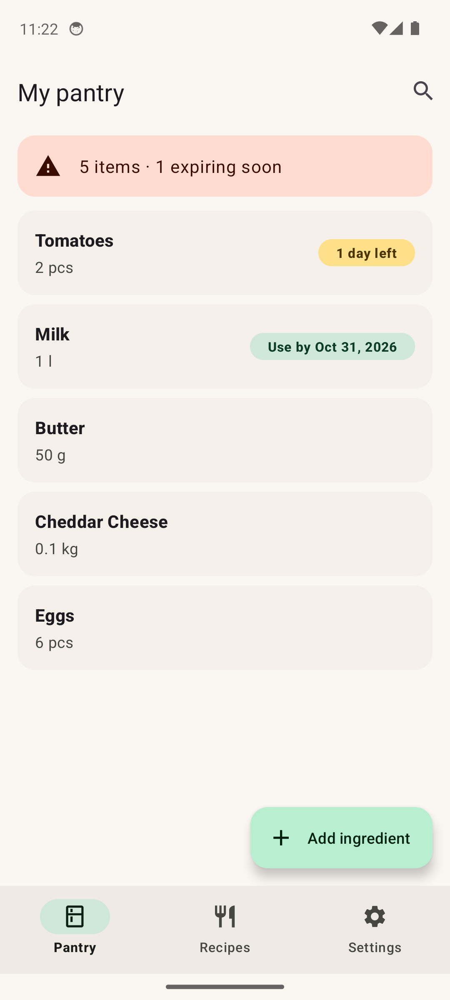
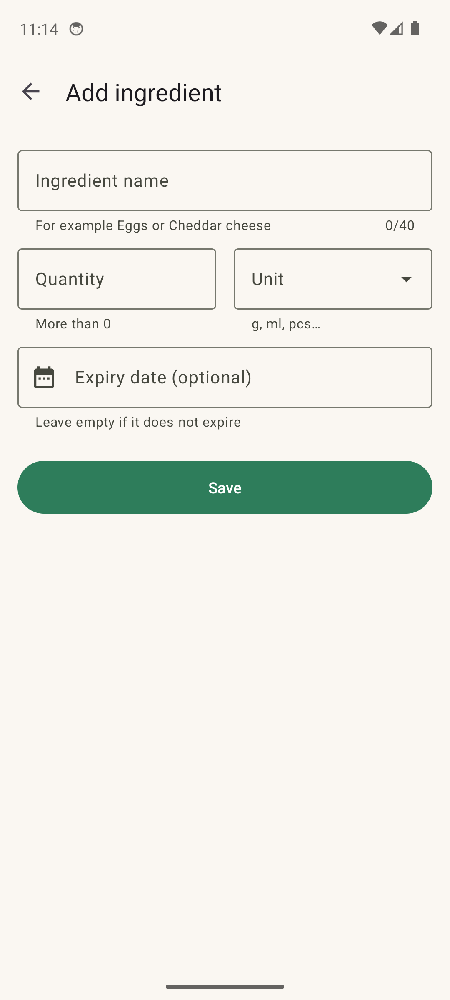
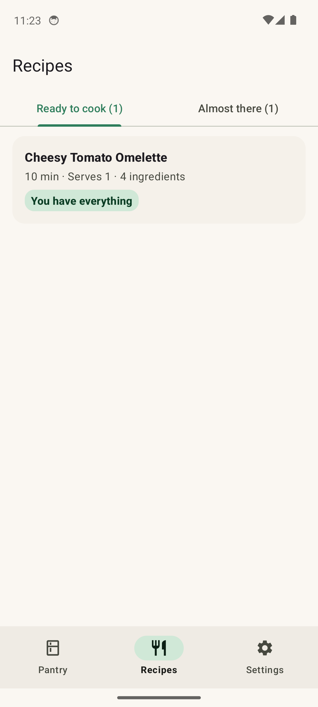
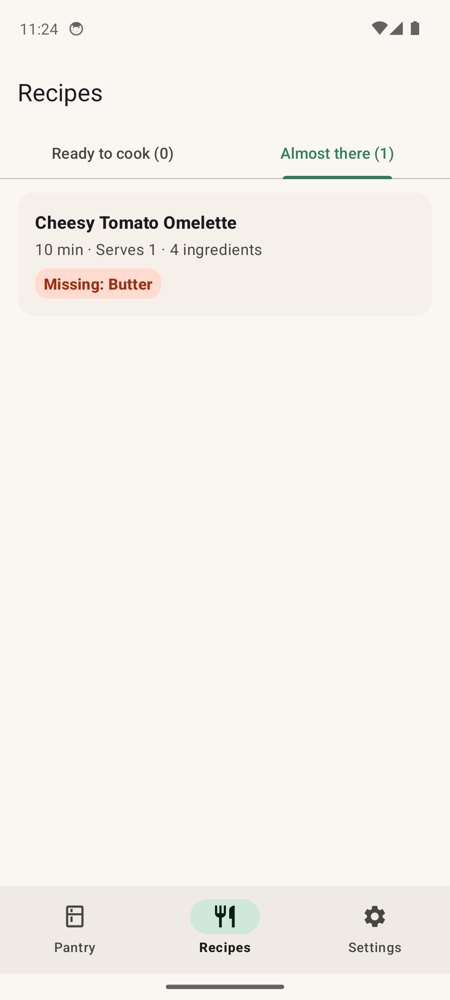
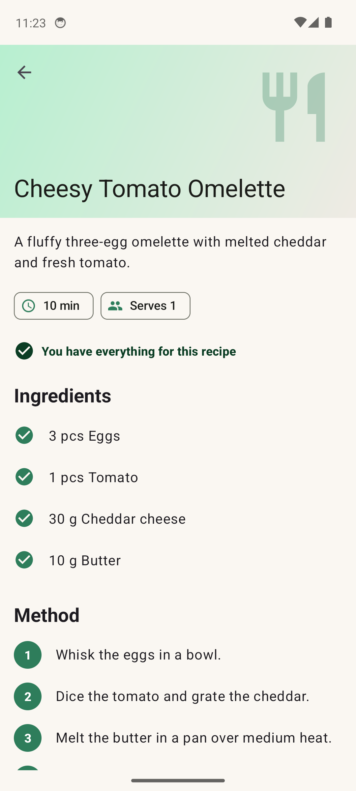
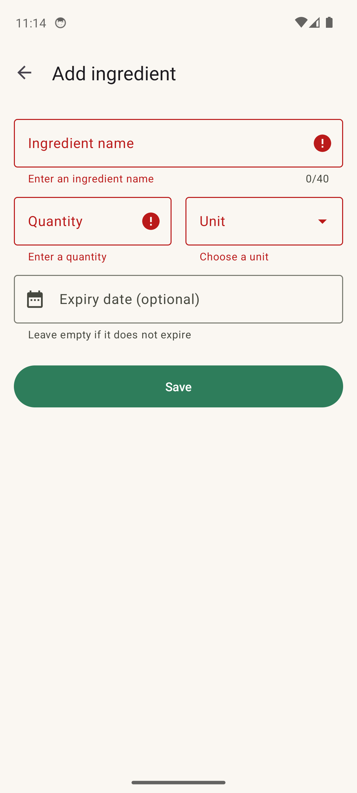
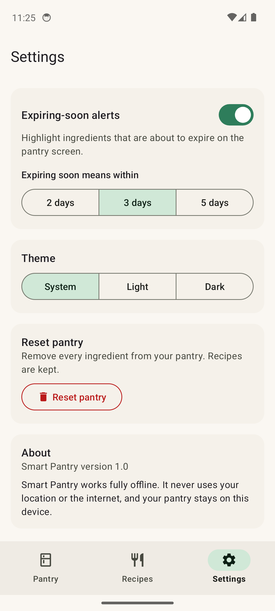
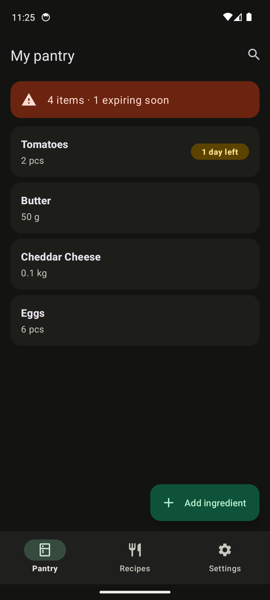

# Smart Pantry Manager

A Java Android app that keeps track of what is in your kitchen and suggests **only the recipes you can cook right now** with exactly what you have, so you can avoid an extra shopping trip and waste less food.

Built for Mobile App Development 700 by **Vysan Chellan**.

Repository: <https://github.com/vysanchellan/mobile_app_developement_assignment>

---

## Features

- **Pantry (full CRUD).** Add, view, edit and delete ingredients with a quantity, a unit and an optional expiry date. Data is stored in SQLite and survives the app being closed or killed.
- **Strict recipe matching.** A recipe appears under *Ready to cook* only when **every** ingredient is in the pantry in **at least** the required amount.
- **Almost there.** A separate tab lists recipes that are short of exactly one ingredient and names it, for example "Missing: Butter" or "Need more: Eggs (3 pcs)". This tab never feeds the strict list.
- **Recipe detail.** Time and servings chips, a tick or cross per ingredient checked live against the pantry, and numbered method steps.
- **Expiry tracking.** Each card has a chip (green = fine, amber = expiring soon, red = expired), and a summary banner shows how many items are expiring soon. Expired items still count for matching, but they are flagged.
- **Input validation.** Inline errors for an empty or invalid name, a missing or zero quantity, a missing unit, and an expiry date in the past.
- **Swipe to delete with Undo**, live search, and a confirmation before unsaved changes are discarded.
- **Settings.** Expiring-soon alerts with a 2, 3 or 5 day window, System/Light/Dark theme, Reset pantry, and an About card.
- **Polish.** Material 3 design, full dark mode, empty states instead of blank screens, works in landscape and at large font sizes, and has content descriptions for screen readers.
- **20 seed recipes** inserted on first run.

## Screenshots

All taken on a Pixel emulator (Android 14). Every screenshot is in [`screenshots/`](screenshots).

| Pantry | Add ingredient | Ready to cook | Almost there |
|---|---|---|---|
|  |  |  |  |

| Recipe detail | Validation | Settings | Dark mode |
|---|---|---|---|
|  |  |  |  |

## Why SQLite?

The database is **SQLite through `SQLiteOpenHelper`** (no Room, no cloud).

- **Offline and personal.** A pantry belongs to one person on one device, so there is no need for a server, an account or an internet connection. The app does not even request the `INTERNET` permission.
- **Built into Android.** There are no extra dependencies, no hosting costs and no backend to secure.
- **Matches the module.** `DatabaseHelper.onCreate` contains the actual `CREATE TABLE` SQL, which makes the schema easy to read, explain and mark.
- **Safe and consistent.** Every query is parameterised (`?` placeholders, never string concatenation). Seeding runs in a single transaction, and foreign keys with `ON DELETE CASCADE` are switched on in `onConfigure`.
- Firebase or PostgreSQL would add a backend and a network dependency without any benefit for a single user's pantry.

User settings such as the theme and expiry window are small key-value data, so they live in `SharedPreferences` rather than the database.

## Database schema

The full SQL is in [`docs/schema.sql`](docs/schema.sql) and is identical to the strings in `DatabaseHelper.java`.

| Table | Purpose | Key columns |
|---|---|---|
| `pantry_items` | What the user has | `name`, `normalized_name`, `quantity` (CHECK > 0), `unit`, `expiry_date` (ISO, nullable), `created_at` |
| `recipes` | The 20 seed recipes | `name`, `description`, `prep_minutes`, `servings`, `steps` (one per line) |
| `recipe_ingredients` | What each recipe needs | `recipe_id` → `recipes(id)` ON DELETE CASCADE, `name`, `normalized_name`, `quantity`, `unit` |

Indexes: `idx_pantry_norm` on `pantry_items(normalized_name)` and `idx_ri_recipe` on `recipe_ingredients(recipe_id)`.

## Architecture

MVVM-lite in plain Java: Activities and Fragments observe `LiveData` from ViewModels, ViewModels talk to one repository, and the repository runs all database work on a single background thread.

```
com.vysan.smartpantry
├── SmartPantryApp.java          applies the saved theme at start-up
├── data
│   ├── db        DatabaseHelper (schema + seeding), PantryDao, RecipeDao, SeedData
│   ├── model     PantryItem, Recipe, RecipeIngredient, AlmostThere
│   └── repo      PantryRepository (single-thread ExecutorService -> LiveData)
├── logic         RecipeMatcher, IngredientNormalizer, UnitConverter, ExpiryHelper, ItemValidator
│                 (pure Java, no Android imports, fully unit tested)
└── ui
    ├── main      MainActivity (BottomNavigationView hosting three fragments)
    ├── pantry    PantryFragment, PantryAdapter, PantryViewModel, AddEditItemActivity, SwipeToDeleteCallback
    ├── recipes   SuggestedFragment, RecipeAdapter, RecipesViewModel, RecipeDetailActivity
    ├── settings  SettingsFragment, Prefs
    └── common    Format, ClickGuard
```

**Navigation.** `MainActivity` switches fragments from the bottom navigation bar. `AddEditItemActivity` and `RecipeDetailActivity` are opened with explicit Intents carrying `EXTRA_ITEM_ID` and `EXTRA_RECIPE_ID`. The add/edit result comes back through `registerForActivityResult`.

**Threads and rotation.** The UI thread never touches SQLite. ViewModels survive rotation, so the list, the search text and the selected recipes tab are not lost. The add/edit form saves its state in `onSaveInstanceState`.

## How strict matching works

`RecipeMatcher.findStrictMatches(pantry, recipes)`:

1. **Normalise the pantry.** Names are lowercased, punctuation is stripped and the last word is singularised (`Tomatoes` → `tomato`, `berries` → `berry`, `leaves` → `leaf`). Words such as `hummus` and `couscous` are left alone, and a small synonym map handles regional names (`capsicum` → `bell pepper`).
2. **Convert to base units** within each family: mass in grams (kg, oz, lb), volume in millilitres (l, tsp, tbsp, cup) and count in pieces (pc, whole, clove, slice). For example, `0.1 kg` becomes `100 g`.
3. **Sum duplicates.** Two rows of butter, `20 g` and `0.015 kg`, add up to `35 g`.
4. For each recipe, **check every ingredient**. If even one is missing, short, or in a different unit family (2 pcs of cheese never satisfies 200 g), the recipe is skipped. Comparison uses an epsilon of `1e-6` so that floating point rounding cannot exclude an exact amount.

**Example:** a recipe needs eggs, milk, flour, sugar and butter. With 4 of the 5 in the pantry it is **not** suggested. It shows up only in *Almost there*, as "Missing: Butter".

These rules are covered by **53 JUnit tests** in `app/src/test`, including the exact demo pantry from the video (Eggs 6, Tomatoes 2, Cheddar 0.1 kg, Butter 50 g), which matches exactly one recipe.

## Setup and run

**Requirements**
- Android Studio, any recent release that supports Android Gradle Plugin 8.11 (built with Android Studio 2026.2)
- JDK 17 (the JDK bundled with Android Studio works)
- Android SDK Platform 36; the app runs on Android 8.0 (API 26) or newer

**Steps**
1. Clone the repository:
   ```bash
   git clone https://github.com/vysanchellan/mobile_app_developement_assignment.git
   ```
2. In Android Studio choose **File > Open** and select the cloned folder.
3. Let Gradle sync finish (Android Studio creates `local.properties` with your SDK path).
4. Start an emulator (for example a Pixel with API 33 or 34) or connect a device, then press **Run**.

**Run the unit tests**
```bash
./gradlew testDebugUnitTest
```
On Windows use `gradlew.bat testDebugUnitTest`.

**Build and lint**
```bash
./gradlew assembleDebug lintDebug
```

## Out of scope

This app deliberately has **no maps, no location or GPS, no nearby-store features, no payments, no network access and no Play Store publishing**. The manifest requests no permissions at all.

## Author

Vysan Chellan, Mobile App Development 700.
