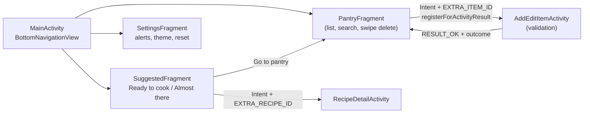
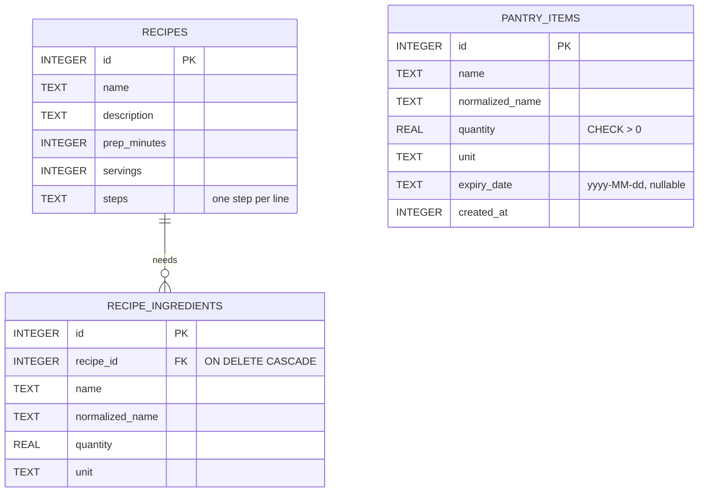

# Smart Pantry Manager: Report Draft

> **Before you submit:** add the Richfield cover page, a table of contents and your signed declaration. Use Times New Roman 12 with 1.5 line spacing, Harvard referencing, and save as `{STUDENTNUMBER}_{SURNAME}_MobileAppDev700_Assignment.docx` (or `.pdf` if your lecturer asks for PDF; the brief allows both, and the Moodle ZIP instructions mention .docx). Replace every screenshot placeholder with **your own** emulator screenshots.

**GitHub repository:** <https://github.com/vysanchellan/mobile_app_developement_assignment>

---

## 1. Introduction

Households and students often throw food away because they forget what is in the cupboard, or they buy extra ingredients for a recipe when they could already have cooked something else. Smart Pantry Manager is a Java Android app that tracks what is in the user's kitchen and suggests **only the recipes that can be cooked right now from exactly what is there**, so no shopping trip is needed.

The target users are students and families who want to cut food waste and save money. The app is fully offline. It needs no account and no internet connection, and it never uses the user's location.

The core rule is strict: a recipe is suggested only if **every** required ingredient is in the pantry in **at least** the required quantity. If a recipe needs five ingredients and four are present, it is not suggested. To keep the app helpful without breaking that rule, a separate *Almost there* tab shows recipes that are short of exactly one ingredient and names what is missing.

## 2. System design

### 2.1 Screen flow



### 2.2 Architecture

The app follows a simple MVVM structure. Fragments and Activities observe `LiveData` exposed by ViewModels (`PantryViewModel`, `RecipesViewModel`). The ViewModels use a single `PantryRepository`, which runs every database call on a single-thread `ExecutorService` and posts the results back to `LiveData`. The matching logic (`RecipeMatcher`, `IngredientNormalizer`, `UnitConverter`) is plain Java with no Android imports, so it is unit tested with JUnit.

### 2.3 Database (SQLite) entity relationship diagram



`pantry_items` is matched against `recipe_ingredients` in Java, by normalised name and converted quantity, rather than by a foreign key. This is because the user types free text such as "Tomatoes" while recipes say "Tomato".

**Why SQLite:** the data is personal and small, and the app must work offline. SQLite is built into Android, needs no server, account or hosting, and keeps CRUD fast on the device. `SQLiteOpenHelper` makes the schema explicit in `onCreate`, seeding runs in a transaction, and every query uses `?` parameters to prevent SQL injection. Firebase or PostgreSQL would add a backend and an internet requirement with no benefit for a single user.

## 3. Screenshots

> Capture these on your emulator (see `docs/SCREENSHOT_CHECKLIST.md`) and paste them in. Never use mock-ups.

| # | Screenshot | Caption |
|---|---|---|
| 1 | _[insert]_ | Figure 1: Empty pantry on first launch, with a friendly prompt to add the first ingredient. |
| 2 | _[insert]_ | Figure 2: Recipes tab with an empty pantry shows a message instead of a blank screen. |
| 3 | _[insert]_ | Figure 3: Add ingredient form with name autocomplete, quantity, unit dropdown and optional expiry date. |
| 4 | _[insert]_ | Figure 4: Validation errors when Save is tapped with empty fields. |
| 5 | _[insert]_ | Figure 5: Validation error for a quantity of 0. |
| 6 | _[insert]_ | Figure 6: Validation error for an expiry date in the past. |
| 7 | _[insert]_ | Figure 7: Completed form ready to save. |
| 8 | _[insert]_ | Figure 8: Pantry list with expiry chips and the summary banner. |
| 9 | _[insert]_ | Figure 9: Edit ingredient screen opened from a pantry card through an explicit Intent. |
| 10 | _[insert]_ | Figure 10: Swipe-to-delete with the Undo Snackbar. |
| 11 | _[insert]_ | Figure 11: Delete confirmation dialog on the edit screen. |
| 12 | _[insert]_ | Figure 12: Ready to cook tab listing only the Cheesy Tomato Omelette. |
| 13 | _[insert]_ | Figure 13: Almost there tab naming the missing ingredient. |
| 14 | _[insert]_ | Figure 14: Recipe detail with ingredient check marks and numbered method. |
| 15 | _[insert]_ | Figure 15: Settings screen. |
| 16 | _[insert]_ | Figure 16: Pantry in dark mode. |
| 17 | _[insert]_ | Figure 17: Pantry in landscape orientation. |

## 4. Key code snippets

### 4.1 Creating the database: `DatabaseHelper.onCreate`

```java
@Override
public void onCreate(SQLiteDatabase db) {
    db.beginTransaction();
    try {
        db.execSQL(SQL_CREATE_PANTRY);
        db.execSQL(SQL_CREATE_RECIPES);
        db.execSQL(SQL_CREATE_RECIPE_INGREDIENTS);
        db.execSQL(SQL_INDEX_PANTRY);
        db.execSQL(SQL_INDEX_RECIPE);
        for (Recipe recipe : SeedData.recipes()) {
            RecipeDao.insert(db, recipe);   // 20 seed recipes, all or nothing
        }
        db.setTransactionSuccessful();
    } finally {
        db.endTransaction();
    }
}
```

**Why:** Android calls `onCreate` once, the first time the database file is opened. Creating the three tables, the indexes and all 20 recipes inside one transaction means a crash halfway through cannot leave a half-seeded database.

### 4.2 Updating and deleting: `PantryDao.update` and `PantryDao.delete`

```java
/** UPDATE: overwrites the row with the item's id; returns the number of rows changed. */
public int update(PantryItem item) {
    SQLiteDatabase db = helper.getWritableDatabase();
    String[] args = {String.valueOf(item.getId())};
    return db.update(TABLE_PANTRY, toValues(item), WHERE_ID, args);
}

/** DELETE: removes one item; returns the number of rows deleted. */
public int delete(long id) {
    SQLiteDatabase db = helper.getWritableDatabase();
    String[] args = {String.valueOf(id)};
    return db.delete(TABLE_PANTRY, WHERE_ID, args);
}
```

**Why:** `WHERE_ID` is `"id = ?"`, and the id is passed separately as an argument, so the value can never change the SQL itself (no SQL injection). `toValues` maps the Java object to `ContentValues` and also stores the normalised name, so lookups can use the index.

### 4.3 The strict rule: `RecipeMatcher.findStrictMatches`

```java
public List<Recipe> findStrictMatches(List<PantryItem> pantry, List<Recipe> recipes) {
    Map<String, Map<UnitConverter.Family, Double>> stock = buildStock(pantry);
    List<Recipe> matches = new ArrayList<>();
    for (Recipe recipe : recipes) {
        if (!canCook(recipe, stock)) continue;   // one missing or short ingredient rules it out
        matches.add(recipe);
    }
    return matches;
}

private boolean canCook(Recipe recipe, Map<String, Map<UnitConverter.Family, Double>> stock) {
    if (recipe.getIngredients().isEmpty()) return false;
    for (RecipeIngredient needed : recipe.getIngredients()) {
        if (!hasEnough(needed, stock)) return false;
    }
    return true;
}
```

**Why:** `buildStock` normalises every pantry name, converts each quantity to a base unit (g, ml or pcs) and sums duplicate rows. `canCook` then fails fast on the first ingredient that is missing or short, so four out of five ingredients can never count as a match. `hasEnough` compares within one unit family with a `1e-6` tolerance for floating point rounding.

### 4.4 Binding a row: `PantryAdapter.onBindViewHolder`

```java
@Override
public void onBindViewHolder(@NonNull ViewHolder holder, int position) {
    PantryItem item = getItem(position);
    Context context = holder.itemView.getContext();
    holder.name.setText(item.getName());
    holder.quantity.setText(context.getString(R.string.quantity_with_unit,
            Format.quantity(item.getQuantity()), item.getUnit()));
    bindExpiryChip(holder.expiry, item.getExpiryDate());
}
```

**Why:** the RecyclerView creates only enough row views to fill the screen and then reuses them, and `onBindViewHolder` fills a recycled row with the item at that position. The adapter extends `ListAdapter` with a `DiffUtil` callback, so when the database changes only the rows that actually changed are redrawn and animated.

## 5. Challenges and solutions

**1. Plural and differently written ingredient names.** Users type "Tomatoes" and "Cheddar Cheese", while recipes say "Tomato" and "Cheddar cheese". A plain string comparison failed. I wrote `IngredientNormalizer`, which lowercases, strips punctuation, collapses spaces and singularises the last word with documented rules (`-ies` → `-y`, `-oes` → `-o`, `-ches` → `-ch`, then a trailing `-s`). An exceptions list covers words like hummus and couscous, plus a small synonym map. Unit tests cover each rule.

**2. Different units and floating point.** A user may enter cheddar as `0.1 kg` while the recipe needs `30 g`. `UnitConverter` converts within mass, volume and count families, and a cross-family comparison (pieces against grams) deliberately fails. While writing tests I found that `1.2 tbsp + 2.95 tbsp` adds up to 62.25 ml, but `4.15 tbsp` converts to 62.25000000000001 ml. A strict `>=` would wrongly reject an exact amount, so the comparison uses an epsilon of `1e-6`, and a unit test locks that in.

**3. Keeping state through rotation and keeping the UI thread free.** SQLite calls on the main thread can freeze the UI, so all database work goes through a single-thread executor in `PantryRepository`, and results come back through `LiveData`. Rotation caused three smaller bugs, which I fixed:
- After rotation, the open date picker lost its listener. I now re-attach it from the FragmentManager.
- The restored unit text filtered the dropdown down to one option. I now set the adapter in `onResume`.
- The keyboard covered the unit list. It now closes when the unit field gets focus.

ViewModels keep the pantry list, the search text and the selected tab when the screen rotates.

## 6. Conclusion and reflection

Smart Pantry Manager meets the brief: it has more than four screens connected by bottom navigation and explicit Intents, a RecyclerView with a custom adapter bound to SQLite, full CRUD that persists across app restarts, input validation, and a strict matching algorithm backed by 53 unit tests. Keeping the matching logic in plain Java classes made it easy to test thoroughly before building any screens. Building the app incrementally, with small commits, made each step easy to verify on the emulator.

If I extended the app, I would add a shopping list generated from the *Almost there* tab, let users add their own recipes, and add a database migration path for future schema versions (version 1 currently only recreates the tables on upgrade). I learned how much small details matter to robustness: unit families, floating point tolerance, and state restoration on rotation.

## 7. References

Android Developers (2026a) *Save data using SQLite*. Available at: https://developer.android.com/training/data-storage/sqlite (Accessed: 11 October 2026).

Android Developers (2026b) *Create dynamic lists with RecyclerView*. Available at: https://developer.android.com/develop/ui/views/layout/recyclerview (Accessed: 11 October 2026).

Android Developers (2026c) *ViewModel overview*. Available at: https://developer.android.com/topic/libraries/architecture/viewmodel (Accessed: 11 October 2026).

Android Developers (2026d) *LiveData overview*. Available at: https://developer.android.com/topic/libraries/architecture/livedata (Accessed: 11 October 2026).

Android Developers (2026e) *Get a result from an activity*. Available at: https://developer.android.com/training/basics/intents/result (Accessed: 11 October 2026).

Google (2026) *Material Design 3*. Available at: https://m3.material.io (Accessed: 11 October 2026).

SQLite (2026) *SQLite foreign key support*. Available at: https://www.sqlite.org/foreignkeys.html (Accessed: 11 October 2026).

Chellan, V. (2026) *Smart Pantry Manager source code*. GitHub. Available at: https://github.com/vysanchellan/mobile_app_developement_assignment (Accessed: 11 October 2026).
